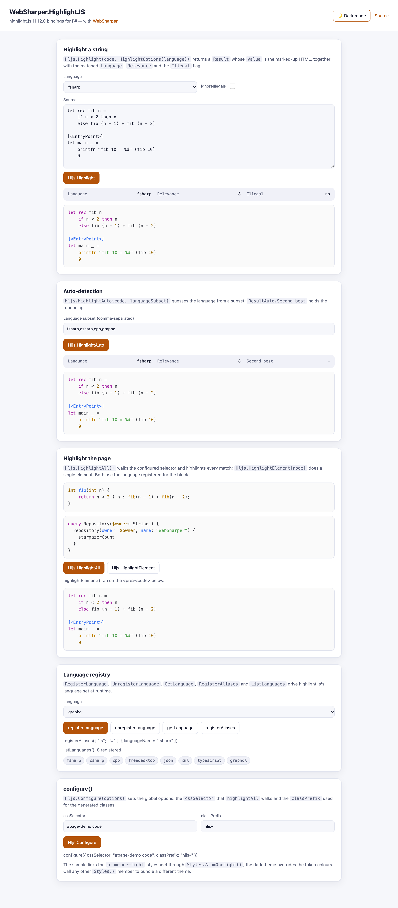

# WebSharper.HighlightJS

[](https://www.nuget.org/packages/WebSharper.HighlightJS)

WebSharper bindings for [highlight.js](https://highlightjs.org/) 11.12 — client-side
syntax highlighting for F# and C# web apps.

The binding consumes the npm [`highlight.js`](https://www.npmjs.com/package/highlight.js)
package as an ES module (`import hljs from "highlight.js/lib/core"`) and is bundled by
your toolchain (esbuild in the sample); there is no CDN `<script>` tag. It wraps the
**core** build, so only the languages and styles you actually reference are bundled.

This repository contains:

| Project | Purpose |
| --- | --- |
| `WebSharper.Highlightjs` | The binding: typed F#/C# wrappers for the highlight.js core API, the full language set (`Language.*`) and the shipped stylesheets (`Styles.*`). |
| `WebSharper.Highlightjs.Sample` | A WebSharper SPA (esbuild → `dist/`) that drives the whole surface: `highlight`, `highlightAuto`, `highlightAll`, `highlightElement`, the language registry (`registerLanguage` / `unregisterLanguage` / `getLanguage` / `registerAliases` / `listLanguages`) and `configure`. |

## Live demos

**Try it live:** [Open the sample in your browser](https://dotnet-websharper.github.io/highlightjs/)



The sample doubles as the binding's [test case](#running-the-test-case): it highlights a
string and the page's `<pre><code>` blocks, auto-detects a language, adds and removes
languages and aliases at runtime, and re-runs `configure`. It is light-themed by default
and has a light/dark theme switcher (persisted in `localStorage`).

- **Sample (this repository):** <https://dotnet-websharper.github.io/highlightjs/>
- **Sample in the WebSharper samples gallery:** <https://websharper-samples.github.io/HighlightJS/>
- **Sample source in the gallery:** <https://github.com/websharper-samples/HighlightJS>
- **WebSharper:** <https://websharper.com>

## Install

```bash
dotnet add package WebSharper.HighlightJS
```

Or with Paket:

```fsharp
nuget WebSharper.HighlightJS
```

The package targets `netstandard2.0` and works with any WebSharper 10 or 11 project.
It supports `highlight.js >= 11.12.0 < 12.0.0`; the JS package is pulled from npm, so
the bundle step must be able to resolve it (WebSharper's SPA/esbuild build does this
automatically).

## Usage

All types live in the `WebSharper.HighlightJS` namespace.

### Highlight a string

```fsharp
open WebSharper
open WebSharper.HighlightJS

[<JavaScript>]
let HighlightFSharp (code: string) =
    Hljs.RegisterLanguage("fsharp", Language.Fsharp)

    let options = HighlightOptions("fsharp")
    options.IgnoreIllegals <- true

    let result = Hljs.Highlight(code, options)
    // result.Value      : the marked-up HTML (spans with hljs-* classes)
    // result.Language   : the language that was used
    // result.Relevance  : a confidence score
    // result.Illegal    : whether illegal syntax was found
    result.Value
```

### Highlight the page

Register the languages you use, then highlight every `<pre><code>` block on the page:

```fsharp
[<JavaScript>]
let HighlightPage () =
    Styles.AtomOneLight()                 // bundles highlight.js/styles/atom-one-light.css
    Hljs.RegisterLanguage("fsharp", Language.Fsharp)
    Hljs.RegisterLanguage("cpp", Language.Cpp)
    Hljs.HighlightAll()
```

To highlight a single element after the fact, call `Hljs.HighlightElement(element)`.

### Language auto-detection

```fsharp
let result = Hljs.HighlightAuto(code, [| "fsharp"; "csharp" |])
let detected = result.Language
let secondBest = result.Second_best  // the runner-up, or null/undefined
```

### The language registry

```fsharp
Hljs.RegisterLanguage("graphql", Language.Graphql)
Hljs.GetLanguage("graphql")            // the registered definition, or undefined
Hljs.ListLanguages()                   // string[] of registered names
Hljs.UnregisterLanguage("graphql")

let aliases = RegisterAliasesOptions()
aliases.LanguageName <- "fsharp"
Hljs.RegisterAliases([| "fs"; "f#" |], aliases)
```

### Global options

`Hljs.Configure` sets the options `HighlightAll` uses, plus the CSS class prefix:

```fsharp
let options = Options()
options.CssSelector <- "#snippets code"
options.ClassPrefix <- "hljs-"
Hljs.Configure(options)
```

### Themes

`Styles` exposes every stylesheet shipped by highlight.js as a static member — calling
one bundles it (`ImportFile`), so only the themes you reference end up in the output:

```fsharp
Styles.AtomOneLight()
Styles.AtomOneDark()
Styles.Github()
Styles.Vs2015()
```

`Language.*` is generated the same way from the npm language files, so
`Hljs.RegisterLanguage("graphql", Language.Graphql)` imports only `graphql`.

### Notes on the API

- `Hljs.Highlight(code, options)` and `Hljs.HighlightAuto(code, subset)` are ordinary
  method calls (they used to compile to curried calls — that is fixed).
- `Hljs.VersionString` returns the loaded highlight.js version (e.g. `"11.12.0"`).
- `Hljs.HighlightBlock`, `Hljs.InitHighlighting` and `Hljs.InitHighlightingOnLoad` are the
  deprecated highlight.js entry points; they are marked `Obsolete` in favour of
  `HighlightElement` / `HighlightAll`.
- `Result.Top` and `Result.Code` are the legacy fields highlight.js still returns; use
  `Result.Value` for the HTML.
- The language and style lists are generated from highlight.js **11.12.0**; `graphql`,
  `freedesktop` and the `1c-light`, `cybertopia-*`, `equinox`, `rose-pine*` and
  `vs-dark` styles were added in this release.

## Running the test case

The sample compiles to static assets in `dist`, so build it and serve that folder:

```bash
dotnet build WebSharper.Highlightjs.Sample/WebSharper.Highlightjs.Sample.fsproj -c Release
dotnet serve -d dist -p 8080          # dotnet tool install -g dotnet-serve
```

Then open <http://localhost:8080>. Use the buttons to exercise each part of the API:
**Hljs.Highlight** re-renders the string pane, **Hljs.HighlightAuto** detects the
language, **Hljs.HighlightAll** / **Hljs.HighlightElement** fill the two page blocks, and
the language-registry and `configure` cards update their status and the `listLanguages`
count. The header button switches between the light and dark themes.

## Building from source

```bash
dotnet tool restore
dotnet paket restore
dotnet build WebSharper.Highlightjs.sln -c Release
```

The binding targets `netstandard2.0`; the sample targets `net10.0`. This is the
WebSharper 10 line, so the compiler (`wsfsc`) runs on the .NET 10 SDK. `./build CI-Release`
and `./build WS-Package` drive the same build through the build-script toolchain.

## Deployment

Pushing to `master` triggers `.github/workflows/ghpages.yml`, which builds the sample in
Release (Paket restore, esbuild bundle) and publishes `dist/` to the `gh-pages` branch.

## Repository layout

```
WebSharper.Highlightjs/          # the binding (WIG definitions, npm-based)
  Main.fs                        # types + [<assembly: Extension>] registration
WebSharper.Highlightjs.Sample/   # SPA sample / test case
  Client.fs
  index.html
  site.css
  esbuild.config.mjs
docs/sample.png                  # real capture of the running sample
nuget/                           # Paket pack template
.github/workflows/ghpages.yml    # build + deploy the sample to gh-pages
```

## License

Apache 2.0 — see [LICENSE.md](LICENSE.md).
